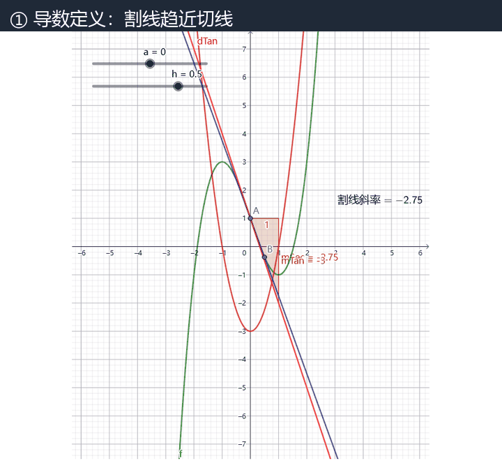
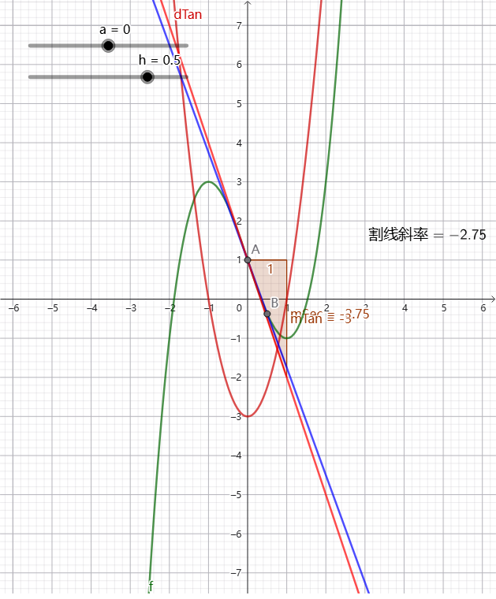
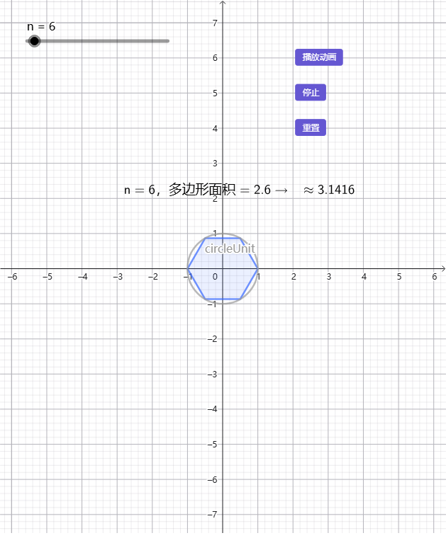
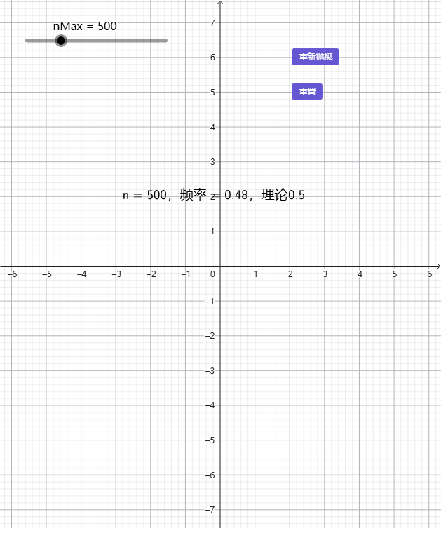

<sub>🌐 <b>中文</b> · <a href="README.en.md">English</a></sub>

<div align="center">

# auto-geogebra

> *「教学创意是一个念头，课堂上能用的是一个 .ggb——中间的每一步，这份技能都替你真机跑过了。」*

[](SKILL.md)
[](LICENSE)
[](https://github.com/zhjx19/auto-geogebra/actions/workflows/smoke.yml)
[](scripts/smoke_test.py)
[](https://skills.sh/zhjx19/auto-geogebra)

**把高校数学教学创意变成可运行、可编辑、可验证的 GeoGebra 动态演示：需求澄清 → 变量设计 → 指令生成 → 双验证 → 真机导出 .ggb。**

[看效果](#效果示例) · [安装](#快速开始) · [触发方式](#触发方式) · [它和同类有什么不同](#它和同类有什么不同) · [安全边界](#安全边界)

</div>

---



<sub>示例（GIF 展示 7 个）：导数定义 · 线性变换 · 球面截交 · 按钮割线 · 正 n 边形逼近圆 · 泰勒近似 · 抛硬币频率。全部由 `tools/ggb-export` 真机导出，.ggb 原件在 [examples/](examples/) 可直接打开。</sub>

---

## 它解决什么问题

事情是这样的：你有一个特别好的教学瞬间——"让学生拖一拖，看见割线怎么变成切线"——然后你把它交给一个 Agent，换来一段看着挺像的 GeoGebra 指令。粘进去，一半命令报错；改完能跑了，滑块初始值为零，两个点重合，图形压根没出来；好不容易画出来了，导出 .ggb 之后按钮又没反应……你知道哪里不对，但说不上来。

GeoGebra 有 500+ 条指令，还有一批**只有真机才暴露的陷阱**：小写变量名加坐标会被当成向量、和内置函数重名（`sec`、`tan`）的对象会被悄悄改名、退化初值会"成功"地什么也不创建、脚本命令恒返回 `false` 但效果真实生效。这不是靠"让模型更聪明"能解决的，需要工具链。

这份技能把"教学创意 → 课堂可用的 .ggb"做成一条有验证的流水线：先跟你确认需求（不瞎猜），再把交互变量设计成表，生成指令后过 **L1 语法 + L2 语义双验证**，最后在本机无头浏览器里调用官方引擎**逐条执行、逐条核验、导出 .ggb 并回读校验**。全程本地运行，零 API Key。

## 效果示例

真实输入（取自 [test-prompts.json](test-prompts.json)）：

```text
"我想让学生理解导数是割线斜率的极限。点 B 沿曲线靠近点 A，割线逐渐逼近切线。"
```

你会拿到（全部来自真实运行，可复现）：

① **需求确认单**——课程、主题、核心变量（含范围/步长/初始值）、待确认问题；
② **指令代码**——通过 L1+L2 双验证，附「语法 0 错 N 警 + 语义 0 错」摘要；
③ **.ggb 文件 + 预览图**——真机导出、逐条核验、回读校验后才交付。



<sub>示例 1 · 导数定义：拖动 h 从 2 到 0.01，割线逐渐逼近切线。源文件 [examples/demo1-derivative-definition.txt](examples/demo1-derivative-definition.txt) · 成品 .ggb 同目录。</sub>



<sub>示例 5 · 正 n 边形逼近圆：滑动 n 观察形状与面积差（内接/外切多边形 + 播放/停止/重置按钮）。</sub>



<sub>示例 7 · 抛硬币频率：一键"重新抛掷"，观察频率稳定到 0.5（按钮脚本经 ggb_patch 注入并回读核验）。</sub>

（其余示例见下表——每个 `.ggb` 都可点开直接运行。）

### 案例索引（7 个真实示例，点名字直接打开 .ggb）

| # | 示例 | 类型 | 亮点 | 打开 |
|---|---|---|---|---|
| 1 | 导数定义 | 逼近 | 割线趋近切线 | [demo1](examples/demo1-derivative-definition.ggb) |
| 2 | 线性变换 | 变换 | 矩阵作用于单位正方形 | [demo2](examples/demo2-linear-transform.ggb) |
| 3 | 球面截交 | 3D | 平面截球面的交线圆 | [demo3](examples/demo3-sphere-cross-section.ggb) |
| 4 | 按钮割线 | 交互 | 按钮控制取点 | [demo4](examples/demo4-button-secant.ggb) |
| 5 | 正 n 边形逼近圆 | 逼近 | 播放/停止/重置按钮对 | [demo5](examples/demo5-polygon-circle.ggb) |
| 6 | 泰勒近似 | 逼近 | 多项式逐阶逼近 | [demo6](examples/demo6-taylor.ggb) |
| 7 | 抛硬币频率 | 随机模拟 | 频率稳定到 0.5（重抽） | [demo7](examples/demo7-coin-toss.ggb) |

<sub>示例 1–7 为技能自带示例。其余主题（中值定理 / 梯度 / 置信区间 / 变上限积分 / 正交投影 / 贝叶斯 / p 值 / Logistic / Fourier 等）的指令写法与真机坑已沉淀在 [references/](references/)，可按需生成。</sub>

## 快速开始

```bash
npx skills add zhjx19/auto-geogebra
```

- 静态验证：Python 3.8+，**无第三方依赖**；
- 真机导出（可选）：Node 18+，本机 Chrome/Edge（首次联网加载官方引擎）；
- **零 API Key**；除引擎首次加载外全程本地，不上传任何教学内容。

装完对 Agent 说：

```text
用 GeoGebra 做一个演示：导数是割线斜率的极限——点 B 沿曲线靠近点 A，
割线逐渐逼近切线。要能拖动观察，通过双验证，直接给我 .ggb 文件。
```

<details>
<summary>Claude Code 插件市场方式（可选）</summary>

本仓库带 `.claude-plugin/marketplace.json`，可在 Claude Code 里通过插件市场双通道安装：`/plugin marketplace add zhjx19/auto-geogebra`。
</details>

## 触发方式

- "把这个知识点做成 GeoGebra 动态演示"
- "做一个能拖动的数学课件，导出 .ggb"
- "帮我设计演示的交互变量和滑块"
- "这些 GeoGebra 指令帮我校验一下"
- "这个概念太抽象了，想让学生看见变化过程"
- "给课堂演示加个重置按钮 / 重新抛掷按钮"
- "帮我把这几个数学概念分别做成小演示"
- "中值定理 / 泰勒展开 / 中心极限定理的演示怎么做"

## 它会交付什么

| 交付物 | 说明 |
| --- | --- |
| 需求确认单 | 已识别信息 + 待确认问题（3-5 个关键项），确认后才动手 |
| 交互变量表 | 变量名 / 含义 / 范围 / 步长 / 初始值，核心与可选分级 |
| GeoGebra 指令 | 附 L1+L2 双验证摘要；静态验证的能力边界如实说明 |
| .ggb 文件 + 预览图 | 真机逐条执行核验 + 回读校验；支持按钮/动画脚本注入 |
| 可改造说明 | 函数输入框、样式、二次创作建议（教师可继续改） |

## 它和同类有什么不同

| 维度 | 直接让 Agent 写指令 | GeoGebra MCP | auto-geogebra |
| --- | --- | --- | --- |
| 指令正确性 | 靠模型记忆，常错 | 依赖已连接的服务 | 500+ 条指令索引 + L1 语法 + L2 语义双验证 |
| 真机验证 | 无 | 有（需环境） | 内置无头导出器：逐条核验 + 回读 + 预览图 |
| 已知陷阱 | 现编现错 | — | 真机实测规则库（向量化 / 保留名 / 退化初值 / 脚本静默失败） |
| 交互按钮 | 无 | 手动 | `ggb_patch.py` 注入 onClick / onUpdate 脚本 |
| 教学场景 | 通用 | 通用 | 需求澄清 + 变量设计 + 29 个高校数学主题路由 |
| 输出 | 一段文本 | 执行结果 | 可双击打开的 .ggb + 预览 + 双验证摘要 |

## 安全边界

- **不替代教师设计**：技能负责把想法变成实现，教学目标与创意始终由教师决定；
- **不伪造产物**：无外网 / 无环境时如实告知，改为交付指令 + 使用说明，不虚构已生成的 .ggb；
- **静态验证的边界会说清楚**：复杂脚本、3D、`Locus` 等静态覆盖不到的内容，明确标注"需实跑确认"；
- **不联网上传**：验证与导出全本地（官方引擎首次加载除外），不上传教学内容；
- **不动你的文件**：只读取你提供的指令/数据，输出写到指定路径。

## 文件结构

```text
auto-geogebra/
├── SKILL.md                      # 主工作流：需求澄清 → 变量设计 → 实现 → 双验证 → 导出
├── test-prompts.json             # 61 个真实测试场景（含预期行为）
├── references/
│   ├── course-routing.md         # 29 个高校数学主题路由表（典型变化 + 核心变量 + 常用指令）
│   ├── command-validation.md     # 指令静态验证检查清单
│   ├── anti-patterns.md          # 常见失败与反例清单（引擎坑 / 验证坑 / 教学反例）
│   ├── patterns.md               # 6 大教学创作模式库
│   ├── interaction-patterns.md   # 按钮 / 动画 / 重置等交互增强模式
│   └── workflow.md               # 教师创作工作流速查
├── scripts/
│   ├── validate_commands.py      # L1 语法验证器
│   ├── validate_types.py         # L2 语义验证器
│   ├── smoke_test.py             # 回归冒烟（31 项，改动验证器后必跑）
│   └── build_index.py            # 指令索引重建工具（维护者）
├── data/
│   ├── commands-index.json       # 500+ 条 GeoGebra 指令索引
│   └── zh-command-aliases.json   # 中文教学意图 → 英文命令映射
├── tools/ggb-export/             # 真机导出工具（零 npm 依赖）+ 按钮脚本注入器
├── examples/                     # 7 个真实示例（指令源 + .ggb + 复现说明）
├── assets/                       # 演示 GIF / 截图 + 可复现的合成脚本
├── .claude-plugin/               # Claude Code 插件市场双通道
└── .github/workflows/            # CI：冒烟 + 双验证（Windows / Ubuntu 矩阵）
```

本目录即技能目录：可直接放入 `~/.config/opencode/skills/`、`~/.claude/skills/`、`~/.codex/skills/` 等安装位使用。

## 验证与测试

```bash
python scripts/smoke_test.py     # 期望：31 项全过（含好样例、埋错、编码边界与真机规则回归）
```

CI：每次 push 自动在 **Windows / Ubuntu** 上跑冒烟与双验证（见仓库 Actions 页）；遇到报错或静默失败，先查 [references/anti-patterns.md](references/anti-patterns.md)。

验收 prompt：任选 [test-prompts.json](test-prompts.json) 一个场景交给 Agent。合格 = 先出需求确认单、指令带双验证摘要、给出可操作的 .ggb（或如实说明环境限制）。

## 致谢

- [鲁班 Skill 工坊](https://github.com/LearnPrompt) —— 打磨流程与发布清单
- [GeoGebra 官方手册](https://github.com/GeoGebra/manual) —— 指令索引的数据来源
- [ggbgen.pages.dev](https://ggbgen.pages.dev/) —— 无本机环境时的在线批量执行备选
- 真机规则与交互模式：来自公开教学案例库的分析沉淀

## License

[Apache License 2.0](LICENSE)

---

<div align="center">

*把下一个教学念头，变成课堂上能拖动的演示。*

</div>
